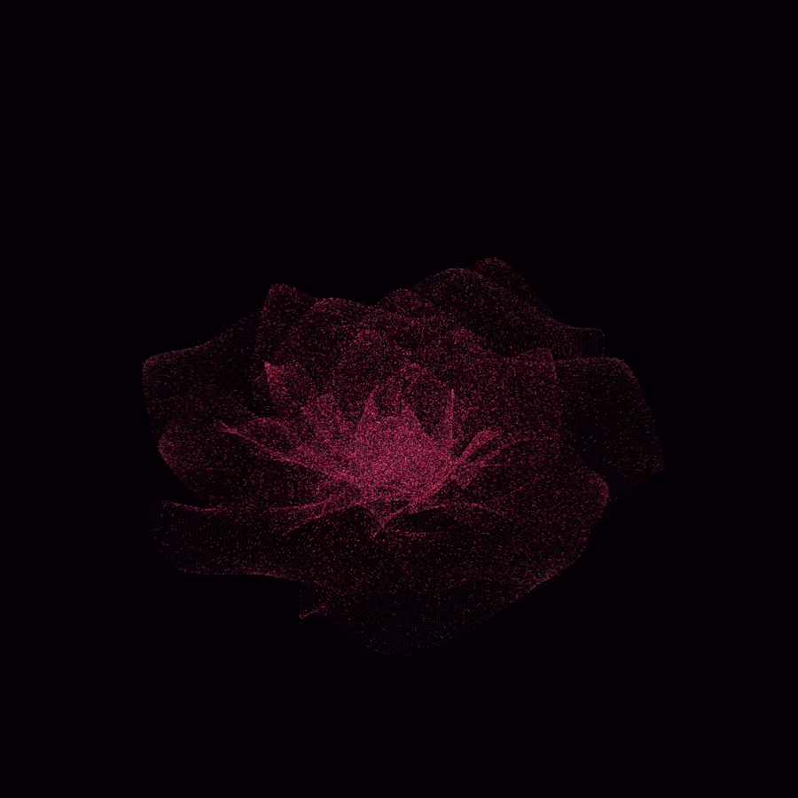

# 酒红粒子花 · Wine Particle Rose

28 片花瓣、280,000 颗粒子组成的酒红色花，浏览器里 WebGL 实时渲染，鼠标可拖动旋转。

**在线预览：** 部署到 GitHub Pages 后访问 `https://<你的用户名>.github.io/<仓库名>/`



## 这是什么

最初是一段 Python + PyVista 的粒子花脚本（见 [`petal_flower.py`](./petal_flower.py)），
这里把同一套几何算法 1:1 移植到 JavaScript + Three.js，做成一个纯静态网页：
不需要安装任何东西，打开就能看，还能拖着转。

## 算法

每片花瓣是一张 `80 × 160` 的参数网格：

```
width_profile = sin(π · v^0.7)
x = u · 0.5 · L · width_profile
y = L − v · L
z = −0.08 · L · sin(4π v) · u² + 0.15 · L · (1 − v)²
```

再按 `v` 做卷曲（`θ = (1 − v) · curl`，只改 y、z），绕 z 轴偏航 22°，
然后按黄金角 `137.508° · n` 螺旋排布、半径 `1 + 1.2n`、缩放 `0.15 + 0.035n`，
每片随机抽 10,000 个点，共 28 × 10,000 = 280,000 颗。

卷曲角分区：`n ≤ 4` → 75°，`n ≤ 11` → 55°，`n ≤ 19` → 35°，其余 5°。

颜色按粒子到中心轴的距离取酒红渐变（花心 `#2e0a1f` → 亮玫红 `#ff6b8a`），
再乘 0.55–1.15 的随机亮度；额外 8% 的粒子用亮玫红加大加点，做出高光。

## 目录

```
index.html     页面骨架
style.css      排版与暗角
app.js         几何生成 + Three.js 渲染 + 交互
vendor/        three.js r180（本地内置，不依赖 CDN）
cover.png      静态渲染图（noscript / og:image 用）
petal_flower.py  原始的 Python 版本
```

## 本地运行

浏览器的 ES module 不能直接 `file://` 打开，起一个静态服务即可：

```bash
python -m http.server 8000
# 然后打开 http://127.0.0.1:8000/
```

## 部署到 GitHub Pages

```bash
git init
git add .
git commit -m "feat: 酒红粒子花 WebGL 页面"
git branch -M main
git remote add origin https://github.com/<用户名>/<仓库名>.git
git push -u origin main
```

推送后在仓库 **Settings → Pages** 里把 Source 选成 `Deploy from a branch`，
分支 `main`、目录 `/ (root)`，保存，一两分钟后即可访问。

## 操作

| 操作 | 效果 |
| --- | --- |
| 拖动 | 旋转视角 |
| 滚轮 | 缩放 |
| 空格 | 暂停 / 继续自转 |
| R | 复位视角 |

## Python 版

```bash
python petal_flower.py           # 开窗口自转
python petal_flower.py --save    # 只导出 petal_flower.png
python petal_flower.py --ssaa    # 显卡支持时开抗锯齿
```

依赖：`pip install numpy pyvista matplotlib`
（注意 PyVista 的 SSAA 在部分集成显卡 / 远程桌面上会因 OpenGL 帧缓冲不完整而崩溃，
默认关闭，需要时再加 `--ssaa`。）
